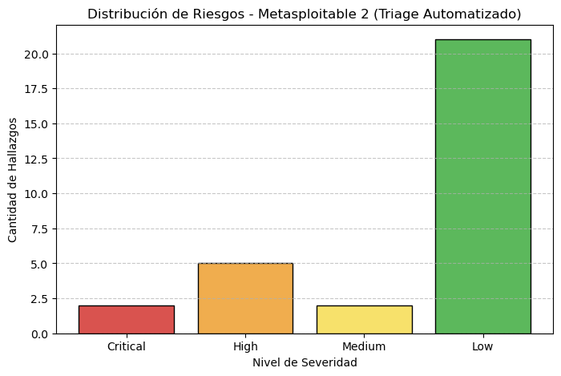

# Automated Vulnerability Triage & Risk Assessment Engine

> An automated triage engine built in Python that processes raw network reconnaissance data (Nmap), calculates risk metrics, and generates executive reports and visualizations for patch prioritization.

---

## Lab Architecture
This project simulates a controlled security auditing scenario to demonstrate end-to-end automation capabilities:
* **Network Environment:** Isolated in **Host-Only** mode within VirtualBox.
* **Attacker Machine:** Kali Linux (Reconnaissance and triage engine).
* **Victim Machine:** Metasploitable 2 (Target server with intentional vulnerabilities).

---

## Workflow Pipeline
The pipeline automates the transition from unstructured data to business intelligence:
1. **Reconnaissance:** Full port and service scan using Nmap (`complete_scan.txt`).
2. **Processing & Analysis (`triage_engine.py`):** Python script that parses plain text, identifies key services/versions, and assigns severity scores based on the CVSS standard.
3. **Artifact Generation:** 
   * Prioritized tabular report (`prioritized_report.csv`).
   * Executive risk distribution chart (`risk_chart.png`).

---

## Executive Summary & Risk Metrics

The script automatically processes findings and generates the following stakeholder-oriented risk distribution:



### Findings Prioritization Table (Excerpt)
| Port | Service | Detected Version | CVSS Score | Risk Level |
| :---: | :--- | :--- | :---: | :---: |
| **21** | ftp | vsftpd 2.3.4 | 9.8 | **Critical** |
| **80** | http | Apache / Tomcat | 7.5 | **High** |
| **22** | ssh | OpenSSH | 5.5 | **Medium** |

You can review the complete report in [prioritized_report.csv](prioritized_report.csv).

---

## How to Run the Project

1. Clone this repository to your local environment:
   ```bash
   git clone [https://github.com/lucasgm94/cybersecurity-labs.git](https://github.com/lucasgm94/cybersecurity-labs.git)
   cd cybersecurity-labs/07-vulnerability-triage-engine